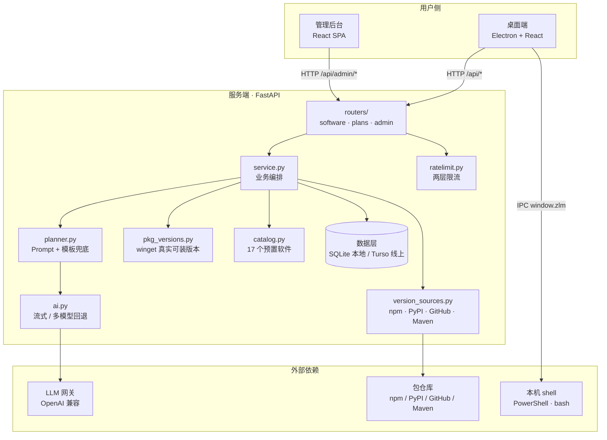
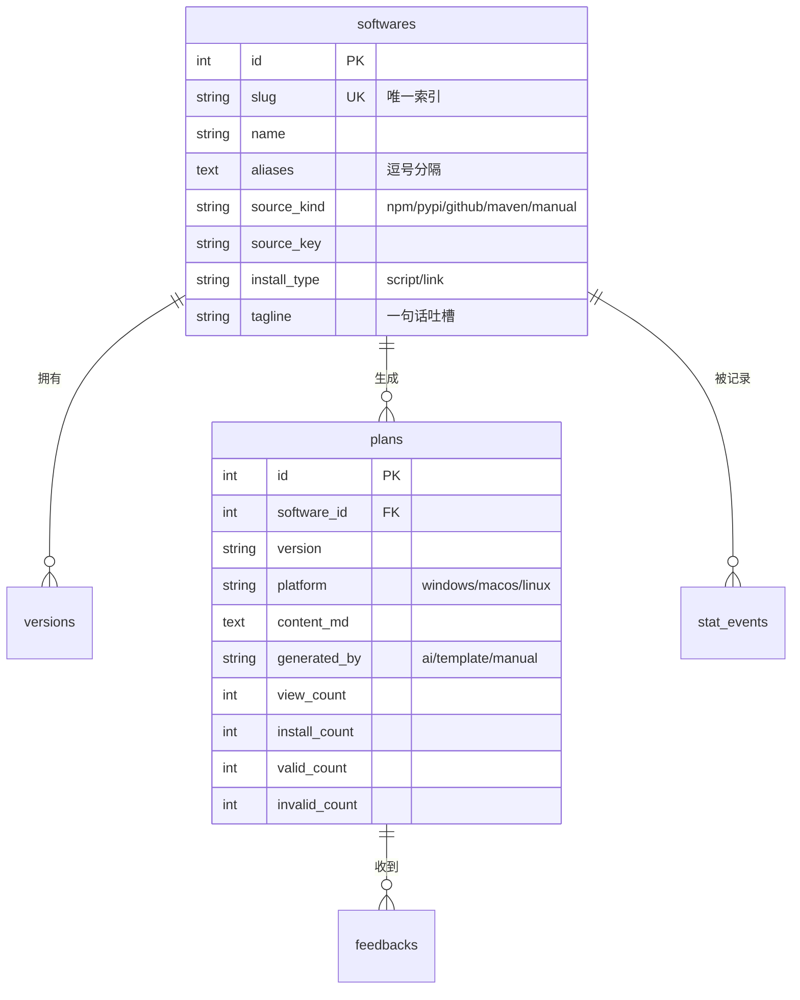
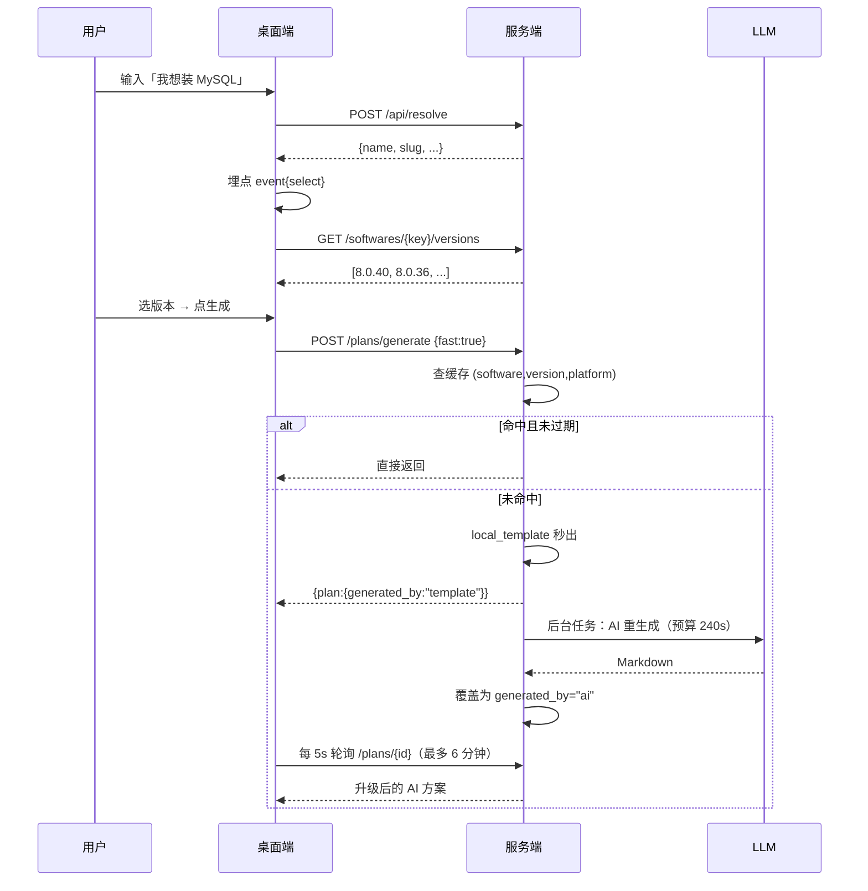
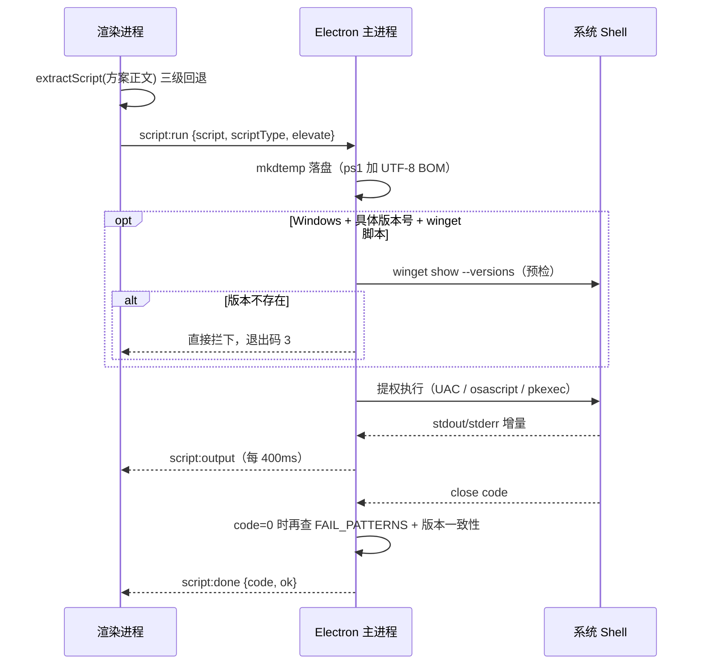
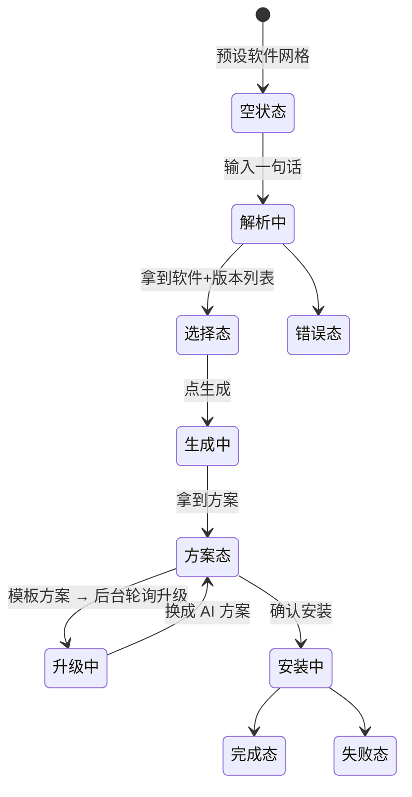

# 装了吗 · 平台整体设计

> 这份文档回答三个问题：**系统由什么组成**、**核心功能怎么实现**、**三端各自怎么设计**。
> 偏实现细节的后端改造记录见 [backend-architecture.md](backend-architecture.md)，部署操作见 [operations.md](operations.md)，
> 打包分发见 [desktop-release.md](desktop-release.md)，本地跑起来见 [development.md](development.md)。

---

## 1. 平台定位

一句话定位：**输入一句「我想装 MySQL」，输出一份可直接执行的安装方案，并能在本机真的装完。**

围绕这句话，平台分成三个端，各自承担不同的价值环节：

| 端 | 目录 | 使用者 | 承担的价值 |
| --- | --- | --- | --- |
| 桌面端 | `desktop/` | 学编程的同学 | 「拿到方案」+「**真的装上**」，是产品的主形态 |
| 服务端 | `server/` | 上述两端 | 数据、AI 生成、版本解析、统计，是唯一的真实数据源 |
| 管理后台 | `admin/` | 维护者 | 看数据、改方案、处理反馈，是运营闭环 |

三者的关系是**互补而非重叠**：桌面端生产数据（生成、安装、投票、埋点），管理后台消费数据（看板、治理），
服务端是唯一的写入口。共通接口只有 `/api/health` 一个。

---

## 2. 整体架构



**关键结构特征：**

1. **服务端是唯一数据源**。两端都不持有业务数据，桌面端只在 localStorage 存一个后端地址。
2. **AI 是可选依赖**。没有 LLM Key 时整条链路自动降级为本地模板，功能不残缺。
3. **桌面端拥有本机能力**。这是它相对浏览器的唯一但决定性的优势——能真执行安装脚本。
4. **数据层双引擎**。Windows 开发用本地 SQLite 文件，Vercel 用 Turso(libSQL)，业务代码无感知（见 backend-architecture.md）。

---

## 3. 核心功能

| # | 功能 | 用户感知 | 实现要点 |
| --- | --- | --- | --- |
| F1 | **一句话搜索** | 输入「我想装 MySQL」直接出结果 | `POST /api/resolve` 四级解析：库内精确 → 库内模糊 → 预置别名 → 在线探测 → AI 提炼 |
| F2 | **版本与平台选择** | 下拉选版本，自动识别当前系统 | 版本五级策略；平台 `process.platform` 自动映射，可手动切 |
| F3 | **方案生成** | 秒出 Markdown 方案 | fast 模式：模板先出 + 后台 AI 升级；非 fast：同步等 AI |
| F4 | **方案渲染** | 代码高亮、逐块复制 | `react-markdown` + `remark-gfm` + Prism，剥离 HTML 注释 |
| F5 | **一键安装** | 点一下，看着日志装完 | 脚本提取 → 落盘 → 提权执行 → 实时日志 → 成功判定 |
| F6 | **反馈闭环** | 有效/无效 + 留言 | 写 `feedbacks` 表，后台可回复 |
| F7 | **统计看板** | 后台看软件/版本/平台/事件分布 | `/api/stats/overview` 聚合 `stat_events` |
| F8 | **方案治理** | 后台改 Markdown、AI 重生成、删除 | 人工改过的方案置 `generated_by=manual`，后台 AI 不再覆盖 |
| F9 | **防刷** | 正常使用无感 | 单 IP 3 次/分钟 + 全局 100 次/天，超限静默降级为模板 |

---

## 4. 数据模型



| 表 | 作用 | 关键约束 |
| --- | --- | --- |
| `softwares` | 软件主数据 | `slug` 唯一索引；`source_kind` 决定版本从哪抓 |
| `versions` | 版本缓存 | 唯一 `(software_id, version)`；`source` 记录来自哪个源 |
| `plans` | 安装方案 | 唯一 **`(software_id, version, platform)`** —— 这是缓存键 |
| `feedbacks` | 投票与留言 | `plan_id` 外键 `ON DELETE SET NULL`，方案删了反馈还在 |
| `stat_events` | 埋点流水 | `event_type` 索引（`select`/`generate`/`install`/`vote`） |

**设计取舍：**

- `plans.software_name` 是**冗余字段**，为了后台检索时不必 join。
- `plans` 上的四个计数器（`view/install/valid/invalid`）**反范式化**存计数，
  避免统计页每次聚合大表；代价是计数与 `stat_events` 可能不完全一致（前者只增、后者是流水）。
- 方案缓存**没有 TTL**，靠 `updated_at` 排序和 `force` 参数失效。

---

## 5. 核心业务流程

### 5.1 从输入到方案（fast 模式）



**fast 模式是这个产品体验的关键**：用户 1 秒内看到东西（模板，脚本完整可用），
AI 在后台把它升级得更贴合版本，前端轮询自动替换，用户感知是「它自己变好了」。

### 5.2 一键安装



---

## 6. 服务端详细设计

### 6.1 模块划分与依赖方向

```
config ← database ← models ← service / routers
                     ↑
        planner → ai → config
        service → version_sources / pkg_versions / catalog
```

| 模块 | 职责 |
| --- | --- |
| `main.py` | 入口、CORS、挂 3 个 router、启动时 seed 17 个预置软件、静态托管 `admin/dist` |
| `config.py` | 配置多级回退：`~/.claude/settings.json` → 环境变量 → `server/.env` |
| `database.py` | 双引擎选择（Turso / 本地 SQLite），只读文件系统时退 `/tmp` |
| `catalog.py` | 17 个预置软件（含 winget/choco/brew/apt ID、bin 路径、验证命令、fallback 版本） |
| `version_sources.py` | npm / PyPI / GitHub / Maven 版本抓取，`timeout=8s`，统一清洗与倒序 |
| `pkg_versions.py` | 调本机 `winget` 拿**真实可装版本**，6 小时进程内缓存 |
| `ai.py` | OpenAI 兼容流式客户端，多模型回退 + 总预算控制 |
| `planner.py` | SYSTEM_PROMPT（15 条硬规则 + 8 个固定小节）、AI 生成、本地模板 |
| `service.py` | 业务编排：解析软件、取版本、生成/缓存方案、埋点 |
| `ratelimit.py` | 进程内滑动窗口 + 数据库每日配额 |

### 6.2 接口分组

| 组 | 端点 | 调用方 |
| --- | --- | --- |
| 健康检查 | `GET /api/health` | 两端（探活 + 判断是否 AI 在线） |
| 软件 | `GET /api/softwares`、`POST /api/resolve`、`GET /api/softwares/{key}/versions` | 桌面端 |
| 方案 | `POST /api/plans/generate`、`GET /api/plans/{id}`、`POST /api/plans/{id}/install`、`POST /api/plans/{id}/vote` | 桌面端 |
| 埋点反馈 | `POST /api/feedback`、`POST /api/events` | 桌面端（**公开，无需鉴权**） |
| 管理 | `POST /api/admin/login`、`GET /api/admin/check`、`PATCH/DELETE /api/admin/plans/{id}`、`POST /api/admin/plans/{id}/regenerate`、`GET/PATCH /api/admin/feedbacks` | 管理后台 |
| 统计 | `GET /api/stats/overview` | 管理后台 |

> `POST /api/plans/generate` 返回的是 `{"plan": {...}}` **包装结构**，方案本体在 `plan` 子对象里。

### 6.3 软件解析（四级）

```
1. 库内精确：id / slug / name
2. 库内模糊：name / aliases LIKE，取名字最短的
3. 预置目录：find_preset 精确名/slug → 别名子串匹配
4. 在线探测：npm / PyPI probe_software
5. AI 提炼：planner.ai_resolve（timeout=30）
   └─ 全都失败：用用户原始输入建一个软件记录
```

### 6.4 版本解析（五级）

```
1. Windows 且有 winget ID → pkg_versions.winget_versions（真实可装，最准）
2. 数据库 versions 表缓存（refresh=false 时）
3. version_sources 按 source_kind 单源抓取（npm / PyPI / GitHub / Maven，8s 超时）
4. 预置 fallback_versions
5. planner.ai_versions（timeout=40）→ 最后兜底 ["latest"]
```

版本清洗规则：剥 `v` 前缀、`_`→`.`，只保留形如 `1.2.3` 的语义化版本，倒序去重，最多 30 个。

### 6.5 AI 链路

- **流式**调用 OpenAI 兼容的 `/v1/chat/completions`，`temperature=0.3`
- **多模型回退**：`LLM_MODEL` → `LLM_MODEL_FALLBACKS` 依次尝试，总预算 `AI_TIMEOUT=180s`
- **部分结果复用**：超时时若已收到 >1200 字符且含「一键安装脚本」章节，直接采用，不浪费
- **输出结构固定 8 节**：一句话 / 官方安装包 / 一键安装脚本 / 怎么运行 / 环境变量 / 安装验证 / 常见问题 / 执行后建议
- **Prompt 注入预置信息**：winget/choco/brew/apt ID、验证命令、版本匹配规则、官方 URL、注意事项

### 6.6 缓存、限流与降级

| 机制 | 设计 |
| --- | --- |
| 方案缓存 | key = `(software_id, version, platform)`；`force=true` 或模板版本过期（`TEMPLATE_VERSION=5` 标记缺失）时失效 |
| 版本缓存 | `versions` 表持久化；winget 结果进程内缓存 6 小时，查询失败保留旧值 |
| 限流一层 | 进程内滑动窗口，`x-forwarded-for` 取 IP，3 次/60 秒，超限 429 带 `Retry-After` |
| 限流二层 | 查当天 `stat_events` 里 `generate` 数量 vs `AI_DAILY_QUOTA=100`，**跨实例共享**；用完只返模板不跑 AI |

降级矩阵（这是本平台最值得注意的设计——**没有任何一个外部依赖是强依赖**）：

| 故障 | 降级行为 |
| --- | --- |
| 无 AI Key | 启动即告警，全程本地模板，功能完整 |
| AI 超时/异常/空响应 | 本地模板兜底 |
| AI 提炼软件名失败 | 用用户原始输入建软件 |
| 版本源全挂 | 预置 fallback → AI → `["latest"]` |
| GitHub 匿名限流 | 配 `GITHUB_TOKEN`；releases 失败退 tags |
| winget 不可用 | 返回空，走上层缓存/在线源 |
| 数据库目录只读 | 退 `/tmp` |
| Windows 无 libsql 二进制 | 强制本地 SQLite |

### 6.7 鉴权

- 登录：`POST /api/admin/login` 校验口令，成功返回 token
- token = `sha256("{username}:{password}:zhuang-le-ma")`，**是口令派生的静态常量，无有效期**
- 校验：请求头 `X-Admin-Token` 与服务端算出的值全等比较，不符 401
- 改口令 → 所有已登录端立即失效

> 这是一个「够用但不严谨」的设计：无过期、无刷新、无法按会话吊销。
> 适合单人维护的小工具；若要多账号或对外，需要换成 JWT/会话表。

---

## 7. 桌面端详细设计

### 7.1 窗口与进程

| 项 | 值 |
| --- | --- |
| 窗口 | 1180×820，最小 940×640，标题「装了吗 · 今天你装了吗？」，背景 `#FFF6E5` |
| 安全 | `contextIsolation: true`、`nodeIntegration: false`，只通过 preload 暴露 IPC |
| 加载 | dev → `loadURL(127.0.0.1:5173)`；生产 → `loadFile(dist/index.html)`；都失败回退 `public/loading.html` |
| 生命周期 | 非 macOS 全关即退出；macOS activate 时重建窗口 |

### 7.2 状态机



顶层状态（`App.tsx`）：`query / platform / software / versions / version / plan / loading / loadingTip /
waited / upgrading / error / presets / aiEnabled / logs / running / showConsole / elevate / confirm / vote / feedback / showSettings`。

加载期的体验细节：每 1.6 秒轮换一句俏皮提示并计时，避免 AI 等待时的空白焦虑。

### 7.3 组件结构

| 组件 | 职责 |
| --- | --- |
| `App.tsx` | 单页全部业务：搜索卡、版本/平台卡、方案卡、预设网格、各弹层 |
| `MarkdownView` | react-markdown + remark-gfm + Prism，剥离 HTML 注释，代码块独立复制（带 textarea 兜底） |
| `InstallConsole` | 底部日志抽屉，按 err/ok/sys 着色，自动滚底，可清屏/停止/收起 |
| `ui/button` `ui/badge` `ui/card` | 基础组件（cva 变体），与管理后台**各自独立实现** |

### 7.4 IPC 契约

`window.zlm` 暴露 5 个能力：

| IPC | 用途 |
| --- | --- |
| `app:info` | 取当前平台（`process.platform` 映射），覆盖默认 windows |
| `script:run` | 执行安装脚本 |
| `script:stop` | 中止（Windows `taskkill /f /t`，其他 `kill(-pid)`） |
| `app:openExternal` | 打开外部链接 |
| `onOutput` / `onDone` | 日志与结果回传 |

### 7.5 安装链路的三个关键设计

**① 脚本提取三级回退**（`api.ts`）：先找「一键安装脚本」小节内匹配当前平台的最长代码块 →
再找全文平台匹配的最长块 → 最后退化为任意脚本最长块。保证任何格式方案都能提取出可执行内容。

**② 编码处理**：ps1 落盘时写 UTF-8 BOM，并强制 `OutputEncoding`，
同时把 `$ErrorActionPreference='Stop'` 降级为 `Continue`——因为 winget 的非零退出码会误杀脚本。
日志解码先试 UTF-8，出现 U+FFFD 再回退 GBK。

**③ 成功判定不只看退出码**：

```
code === 0  → 再查 9 条 FAIL_PATTERNS（"cannot find"、"失败" 等）
              → 再比对实际安装版本与期望版本，不一致则告警
code === 3  → winget 预检发现版本不存在，已提前拦下
```

### 7.6 本地存储

只有一个 `localStorage['zlm:api-base']`——用户手动填过的后端地址，优先级高于构建时注入的默认值。

---

## 8. 管理后台详细设计

### 8.1 结构

无路由库，用 `tab: 'plans' | 'feedbacks' | 'stats'` 条件渲染三块。
登录前是 `Login` 组件，token 存在 `localStorage['zlm:admin-token']`。
`load()` 在 token 变化时并发拉 `Promise.all([plans, feedbacks, stats])`，一次拿全量。

### 8.2 三个模块

| Tab | 内容 | 交互特点 |
| --- | --- | --- |
| 方案管理 | 表格：ID / 软件 / 版本 / 平台 / 来源 / 浏览 / 安装 / 有效·无效 / 操作 | 搜索是**前端过滤**；编辑弹窗左编辑右实时预览；删除有二次确认；AI 重生成同步等待 |
| 用户反馈 | 卡片列表：投票徽标 / 软件版本平台 / 内容 / 回复 | 状态筛选（`pending`/`resolved`）**前端过滤**；回复用 `prompt()` 取文本，一次调用同时置为已处理 |
| 数据统计 | 4 个 BarList（软件 / 版本 / 平台 / 事件）+ 最受欢迎方案 | 条形宽度按 `count/max*100%`，非零基线 |

**统计口径**：`top_plans` 按 `(valid_count + invalid_count) DESC, view_count DESC` 取前 10——
即**总投票数优先**，不是按浏览或安装排序。

### 8.3 后端地址

- 开发环境：`import.meta.env.DEV` → 空串，走 Vite 代理（`/api` → `8899`，端口 5180），**同源**
- 生产环境：URL 参数 `?api=` → localStorage → 默认 `127.0.0.1:8899`，**跨域直连**
- 设置弹窗可填地址并调 `/api/health` 测试，保存后 `location.reload()`

> 因此调 `CORS_ORIGINS` 时后台不受影响（开发同源），桌面端会立刻受影响。

---

## 9. 三端契约小结

| 项 | 桌面端 | 管理后台 |
| --- | --- | --- |
| 后端地址来源 | `.env.development` / `.env.production`（可被 localStorage 覆盖） | Vite 代理 / `?api=` / localStorage |
| 是否跨域 | 是，走 CORS 白名单 | 开发同源，生产跨域 |
| 鉴权 | 无 | `X-Admin-Token`，401 自动登出 |
| 请求封装 | `fetch`，**无超时、无重试** | `fetch`，401 清 token，无重试 |
| 错误处理 | 统一 `setError('没搞定/生成失败：'+msg)` | 调用处 try/catch，无统一 toast |
| 数据方向 | 生产 | 消费 |
| 本机能力 | 提权执行、实时日志、中止 | 无 |

---

## 10. 非功能设计

| 维度 | 现状 | 说明 |
| --- | --- | --- |
| 性能 | fast 模式 1 秒内出方案 | 模板秒出 + 后台 AI，是核心体验设计 |
| 成本 | AI 调用按方案缓存，同 `(软件,版本,平台)` 只生成一次 | 每日 100 次配额兜底 |
| 可用性 | 无任何强外部依赖 | 降级矩阵见 6.6 |
| 安全 | 管理接口靠静态 token；`feedback`/`events` 公开 | 见「已知限制」 |
| 跨平台 | Windows 一等公民，macOS/Linux 脚本与提权已实现 | macOS 包未签名，安装需手动放行 |
| 可观测 | 无结构化日志、无链路追踪 | 靠 uvicorn 访问日志 + 数据库计数 |

---

## 11. 设计决策记录

| 决策 | 选择 | 放弃的方案 | 原因 |
| --- | --- | --- | --- |
| 桌面端框架 | Electron | Tauri / 原生 | 生态成熟、NSIS 打包现成；包大（87MB）可接受 |
| 数据层 | 本地 SQLite + 线上 Turso 双引擎 | 统一用 Turso | 官方方言不支持 Windows，逼出双引擎（见 backend-architecture.md） |
| 方案生成 | 模板先出 + 后台 AI 升级 | 同步等 AI | AI 要 30-150 秒，同步等体验不可接受 |
| 版本来源 | winget 优先 | 只用在线仓库 API | winget 反映**本机真实可装**的版本，装不上比版本新更糟 |
| 方案缓存键 | `(软件, 版本, 平台)` | 只按软件 | 同软件不同版本/平台方案差异很大 |
| 鉴权 | 口令派生静态 token | JWT / 会话表 | 单人维护够用，实现成本最低 |
| 前端形态 | 桌面端 + 独立后台 | 一个应用内切角色 | 使用者与维护者是两类人，权限模型不同 |
| 组件复用 | 各端独立复制 | 抽共享包 | 初期快，但已产生样式漂移（见已知限制） |

---

## 12. 已知限制与演进方向

| 限制 | 影响 | 建议 |
| --- | --- | --- |
| 管理 token 无有效期、无法按会话吊销 | 泄露即长期有效 | 换 JWT 或加会话表 |
| 登录页明文提示默认口令 | 线上部署会泄露口令提示 | 生产构建时隐藏该提示 |
| `/api/feedback`、`/api/events` 公开 | 可被刷 | 加轻量验证码或频率限制 |
| 两端 UI 组件各自复制（Button/Card/Badge） | 样式已漂移（Button `h-11` vs `h-10`） | 抽 `packages/ui` 共享 |
| 后台列表无分页，前端全量过滤 | 数据量大后卡顿 | 后端分页 + 服务端过滤 |
| 桌面端请求无超时无重试 | 弱网会一直转圈 | fetch 加 `AbortController` + 有限重试 |
| 方案缓存无 TTL | 上游软件变化不会自动反映 | 加 `force` 或按时间失效 |
| macOS 包未签名 | Gatekeeper 拦截 | 买开发者账号签名公证 |
| 无结构化日志与告警 | 线上问题难定位 | 接入日志服务 + 关键指标告警 |
