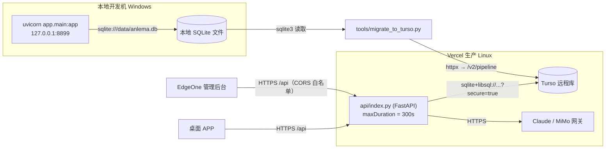

# 后端架构设计：从 `/tmp` SQLite 到 Turso 持久化

> 记录 2026-10 这次改动的**设计决策与实现原理**。运维操作（环境变量、迁移、排障）见 [operations.md](./operations.md)。

## 一、要解决的问题

改造前的线上后端有两个致命问题，根因不同但表现都是"功能不可用"。

### 1. 数据存不住

`server/app/database.py` 的原始逻辑：

```python
def _ensure_db_dir():
    """Vercel / Lambda 只读文件系统，mkdir 会抛 OSError，所以试探后退回 /tmp"""
    try:
        settings.DB_PATH.parent.mkdir(parents=True, exist_ok=True)
        probe = settings.DB_PATH.parent / ".write_probe"
        probe.touch(); probe.unlink()
    except OSError:
        settings.DB_PATH = Path("/tmp") / settings.DB_PATH.name
```

Vercel 的根文件系统只读，只有 `/tmp` 可写。于是线上数据库落在 `/tmp/anlema.db`——**函数实例一回收，文件连同数据一起消失**。线上表现：每次冷启动 `plan_count` 都是 0，用户提交的反馈和投票活不过一次实例回收。

### 2. AI 生成永远只有模板

```python
asyncio.create_task(
    _upgrade_in_background(plan.id, software_to_dict(sw), version, platform)
)
return plan
```

`asyncio.create_task` 启动的协程依附于当前请求进程。serverless 在响应返回后立即冻结/回收实例，任务被直接杀掉；即便不被杀，Hobby 默认 10 秒的 `maxDuration` 也远不够 AI 写一份完整方案所需的 200–600 秒。

**结论：`generated_by` 在线上永远是 `template`。**

## 二、约束条件（决定了方案形态）

| 约束 | 内容 | 影响 |
| --- | --- | --- |
| 开发机 | Windows | 官方方言装不上 |
| 运行时 | Vercel / Linux | 需要远程数据库 |
| 官方 SQLAlchemy 方言 | `sqlalchemy-libsql` 状态 experimental，**只发布 Linux/macOS 二进制** | 必须双引擎 |
| 数据库选择 | Turso（libSQL，SQLite 官方分支） | 语义兼容，业务代码零改动 |
| 免费额度 | 500 库 / 9GB / 月 5 亿行读 / 2500 万行写 | 当前规模（613 行）远未触及 |
| 函数时长 | Hobby + Fluid Compute，实测 `maxDuration: 300` 可用 | AI 预算按 240 秒设计 |

## 三、总体架构



两个入口共用同一份代码，唯一差别是 `database.py` 在导入时根据运行环境选择引擎。

## 四、数据层：双引擎设计

### 4.1 分支条件

```python
def _turso_engine_url() -> str | None:
    raw = (settings.TURSO_DATABASE_URL or "").strip()
    if not raw or not settings.TURSO_AUTH_TOKEN:
        return None
    if sys.platform.startswith("win"):     # 方言只有 Linux/macOS 二进制
        return None
    host = raw.split("://", 1)[1] if "://" in raw else raw
    return f"sqlite+libsql://{host.strip('/')}?secure=true"
```

三个条件**同时满足**才走远程：配了地址、配了 token、平台不是 Windows。

> 这一条 `sys.platform` 判断是关键。它保证了：即使有人在 Windows 机器的 `.env` 里填了 Turso 凭据，本地依旧老老实实连本地文件，**开发体验与改造前完全一致**（已实测回归：`ok=True 软件=17 方案=15`）。

### 4.2 连接串格式

官方 README 要求 host 部分**不带 scheme**，`secure=true` 必须显式加：

```python
engine = create_engine(
    "sqlite+libsql://anlema-houj.aws-ap-northeast-1.turso.io?secure=true",
    connect_args={"auth_token": settings.TURSO_AUTH_TOKEN},
    pool_pre_ping=True,      # serverless 实例回收后连接会变僵，取用前先探活
    future=True,
)
```

用户填的是 `libsql://host`，代码里 `split("://", 1)[1]` 取 host 再重组，所以填 `libsql://`、`https://` 或不带 scheme 三种写法都能用。

### 4.3 方言必须显式导入

```python
if _remote_url:
    import sqlalchemy_libsql  # noqa: F401  注册 sqlite+libsql 方言
```

`create_engine("sqlite+libsql://...")` 依赖方言已注册，而注册发生在 `import sqlalchemy_libsql` 时。这个导入**只能放在远程分支里**——放到模块顶层的话，Windows 上会因为包不存在直接崩。

### 4.4 依赖按平台限定

```
# requirements.txt
sqlalchemy-libsql; platform_system != "Windows"
```

pip environment marker：Windows 本地安装时整条跳过（连带依赖），Vercel 构建时正常安装。

### 4.5 业务层为什么不用改

`models.py` 全部是标准类型（Integer / String / Text / DateTime / ForeignKey / UniqueConstraint），五张表：

```
softwares → versions
          → plans → feedbacks
stat_events（独立）
```

建表靠 `Base.metadata.create_all()`，业务层全是 ORM 查询，**没有裸 SQL、没有 SQLite 私有语法**。所以换引擎不需要动任何业务代码。

## 五、数据迁移：绕开方言，走 HTTP API

### 5.1 为什么不复用 SQLAlchemy

Windows 装不上 `sqlalchemy-libsql`，所以迁移脚本如果依赖 SQLAlchemy 连远程，就会在开发机上跑不起来。改用 Turso 的 HTTP 接口（`POST /v2/pipeline`），只依赖项目已有的 `httpx`，跨平台可用。

### 5.2 关键实现点

| 问题 | 处理 |
| --- | --- |
| 建表（模型 → DDL） | `CreateTable(table).compile(engine)` 生成 SQLite 方言 DDL，替换成 `CREATE TABLE IF NOT EXISTS`，索引同理 |
| 外键顺序 | `softwares → versions → plans → feedbacks → stat_events` |
| 幂等 | `INSERT OR IGNORE`，按主键 id 判重，重跑不会产生重复数据 |
| 悬空外键 | 本地 SQLite 默认不校验外键，历史数据里有指向已删除方案的 `plan_id`；Turso 严格校验会报 `FOREIGN KEY constraint failed`，所以先按 `FK_MAP` 把无效引用置 NULL |
| 系统代理干扰 | `httpx.Client(trust_env=False)`，否则本机 `http_proxy` 会让客户端走 CONNECT，TLS 握手直接失败 |
| 吞吐 | 每批 80 条语句打包成一个 pipeline 请求 |

首次迁移结果：

```
softwares 17 / versions 379 / plans 15 / feedbacks 29 / stat_events 173   共 613 行
（清洗 4 个悬空外键）
```

### 5.3 复跑安全性

脚本只读本地库，不写不删。重复执行时 `INSERT OR IGNORE` 会跳过已存在的 id，线上不会被覆盖或重复。实测第二次运行：`versions 379 变 379`。

## 六、AI 生成链路改造

### 6.1 从 `create_task` 到 `BackgroundTasks`

```python
# 线上：交给 BackgroundTasks，ASGI 请求周期会等它跑完（受 maxDuration 约束）
background_tasks.add_task(
    _upgrade_in_background, plan.id, software_to_dict(sw), version, platform
)

# 本地常驻进程：协程方式即可
asyncio.create_task(_upgrade_in_background(...))
```

差别在于生命周期归属：`BackgroundTasks` 的任务挂在当前请求的 ASGI 周期上，Vercel 会等它执行完才关闭请求；`create_task` 起的是"无人托管"的任务，响应一结束就没人管了。

### 6.2 时间预算

| 项 | 值 | 说明 |
| --- | --- | --- |
| `vercel.json` → `maxDuration` | **300 秒** | Hobby 实测可用（147 秒的请求成功跑完，证明不是 60 秒封顶） |
| `_upgrade_in_background` → AI 超时 | **240 秒** | 留 60 秒给启动、建连接、写回数据库 |

### 6.3 实测结果

```
提交 generate(fast=true) → 立刻返回模板（5305 字，不等 AI）
[147s] 来源变为 ai 长度=6027
🎉 AI 升级完成，耗时 147 秒
```

直连 Turso 校验，落库确认：

```
id=6 | Git | 2.56.0 | windows | generated_by=ai | 6027 字符
```

### 6.4 前端如何感知

不需要新增接口。`Plan.generated_by` 就是状态位：

| 值 | 含义 |
| --- | --- |
| `template` | 模板已出，AI 还在写 |
| `ai` | AI 版本已写好 |
| `manual` | 人工编辑过，后台不再覆盖 |

前端拿模板后轮询已有的 `GET /api/plans/{id}` 即可。

## 七、访问控制

### 7.1 CORS 白名单

改造前 `CORS_ORIGINS` 默认 `*`，任何站点都能读写接口。现在收紧为显式白名单（配置在环境变量里，代码零改动）：

```
CORS_ORIGINS=https://anlema-admin-kgihmudk.edgeone.cool,
             http://127.0.0.1:5173,http://localhost:5173,
             http://127.0.0.1:8899,http://localhost:8899
```

`main.py` 本身就是白名单感知的：

```python
allow_origins=["*"] if settings.CORS_ORIGINS == "*" else settings.CORS_ORIGINS.split(",")
```

实测：`example.com` 的请求不再返回 `access-control-allow-origin`（浏览器拦截），EdgeOne 域名正常回显。

> 注意 `allow_credentials=True` 与通配符并存时，Starlette 不会回 `*` 而是回显来源。改成白名单后行为更明确。

### 7.2 生成接口限流（两层）

`POST /api/plans/generate` 每次会触发一次后台 AI（几千 token）。无鉴权时，一个脚本循环调用就能烧掉额度。防护分两层：

| 层次 | 实现 | 参数 | 作用范围 |
| --- | --- | --- | --- |
| 单 IP 频率 | 进程内滑动窗口（`deque`） | 3 次 / 60 秒 | 单个函数实例 |
| 每日总额度 | 查数据库当天 `generate` 事件数 | 100 次 / 天 | 跨实例共享 |

```python
check_rate(request, key="generate", limit=settings.GENERATE_RATE_LIMIT, window=60)

if background_tasks is not None and not ai_quota_left(db, per_day=settings.AI_DAILY_QUOTA):
    background_tasks = None      # 额度用完：只给模板，不报错
```

为什么需要两层：serverless 每个实例内存独立，攻击者被分散到几十个实例时，第一层形同虚设；而额度记在 Turso 里，是真正的全局上限。

为什么超额不报错：直接降级成模板响应，正常用户完全无感，只有想刷的人受影响。

实测：连打 4 次 → `200 / 200 / 200 / 429（请 45 秒后再试）`。

## 八、关键决策记录

| 决策 | 选择 | 放弃的方案 | 理由 |
| --- | --- | --- | --- |
| 数据库 | Turso（libSQL） | Postgres（Neon/Supabase）、Blob 存文件 | 用户要求保持 SQLite 语义；Blob 方案多实例并发写会丢数据 |
| 引擎策略 | 双引擎 | 全平台统一远程 | 方言不支持 Windows，统一会导致本机跑不起来 |
| 迁移通道 | HTTP API + httpx | SQLAlchemy 直连 | 同上，Windows 上装不了方言 |
| AI 方案 | BackgroundTasks + 300 秒 | 纯状态机轮询、升级付费计划 | 实测 147 秒完成，一次请求内跑完最简单，前端无需改协议 |
| 限流 | 内存窗口 + 数据库日额度 | 只做内存、只做数据库 | 内存层挡住即时刷量（快），数据库层兜底总量（准） |

## 九、已知限制

1. **CORS 白名单与前端域名强绑定**。EdgeOne 若重新部署换了域名，需要同步更新 `CORS_ORIGINS` 并重新部署，否则后台会被浏览器拦截。
2. **单 IP 限流跨实例不精确**。极端并发下实际放行次数会高于 3 次/分钟，靠日额度兜底。
3. **AI 240 秒预算**。复杂软件（如需要写很长脚本的场景）可能在 240 秒内写不完，此时保留模板不升级。若成为常态，可考虑缩短 prompt 或换更快的模型。
4. **`sqlalchemy-libsql` 标注 experimental**。升级 SQLAlchemy 大版本时需回归验证。
5. **迁移脚本不做增量同步**。它用于一次性搬迁；线上新增数据不回写本地，两边会逐渐分叉（本地开发应以线上为准，或干脆连远程调试）。
